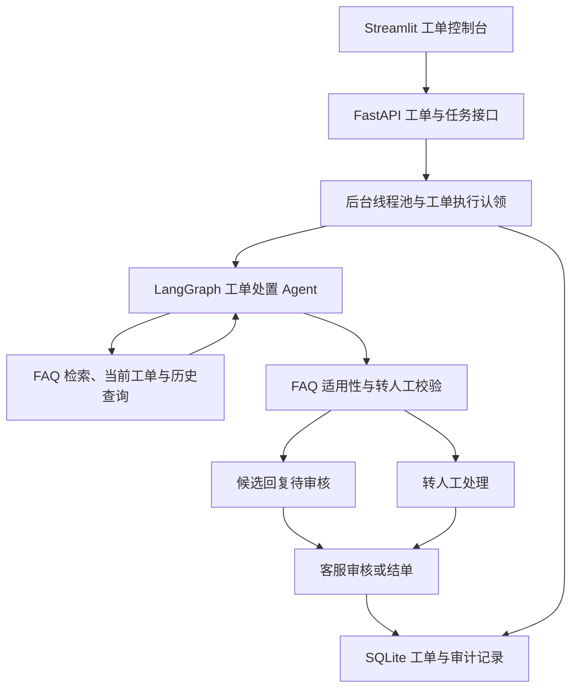

# TicketFlow · 企业智能工单 Agent

TicketFlow 面向模拟 SaaS 客服工单场景。用户提交问题后，系统通过异步任务调用 DeepSeek Agent，检索产品 FAQ 或读取当前工单上下文，再按业务规则生成**待人工审核的候选回复**或**转人工处理**。客服可在 Streamlit 控制台批准、驳回或人工处理工单，系统保留状态变更、审核意见和 Agent 执行记录。

**技术栈** · Python 3.10 · FastAPI · LangGraph · DeepSeek API · SQLite / SQLAlchemy · Streamlit · pytest

## 业务流程与架构



- **Agent 工具调用**。模型可以选择 `search_faq`、`get_ticket` 和 `get_history`。工单与历史工具使用服务端提供的当前工单上下文。系统限制模型轮次、实际工具执行次数和单次请求输出长度，并在收到响应后检查累计 Token。
- **证据与人工审核**。FAQ-001 支持密码重置咨询。系统检查工具实际返回的证据、FAQ 的适用条件和已知风险，候选回复取自已审核的 FAQ。客服可批准候选回复并结单、驳回并转人工，或记录人工处置后结单。
- **异步任务与容量控制**。`POST /tickets/{id}/process-async` 受理后返回 HTTP 202 和任务 ID，可通过 `GET /agent-tasks/{task_id}` 查询进度。SQLite 工单认领协调同步与异步入口，线程池和信号量限制后台执行及在途任务。实验配置为单进程、2 个执行槽、最多 4 个在途任务。
- **恢复与观测**。单实例重启时对账遗留任务，已有处理结果的任务可补记完成，无法确认完成的任务标记失败。工单页可查工具名称、节点轨迹、可见 Token、耗时及异常。演示访问使用共享管理员密钥，审核人字段用于记录演示操作。

## 快速启动

从项目根目录执行。AutoDL 原环境可直接激活已有的 `.venv`。

```bash
python3 -m venv .venv
source .venv/bin/activate
python -m pip install -r requirements.txt
cp -n .env.example .env
```

在 `.env` 填写 `DEEPSEEK_API_KEY` 和 `TICKETFLOW_ADMIN_TOKEN`，后者至少 32 个字符。`DEEPSEEK_BASE_URL` 与 `DEEPSEEK_MODEL` 按实际服务配置。密钥存放在本机 `.env` 中，提交时使用 `.env.example` 作为配置示例。

**终端 A · FastAPI**

```bash
source .venv/bin/activate
TICKETFLOW_ANALYZER=agent TICKETFLOW_REQUIRE_AUTH=1 TICKETFLOW_LEGACY_STATUS_WRITES=0 \
python -m uvicorn app.main:app --env-file .env --host 127.0.0.1 --port 8000 --workers 1
```

**终端 B · Streamlit**

```bash
source .venv/bin/activate
NO_PROXY=127.0.0.1,localhost no_proxy=127.0.0.1,localhost \
TICKETFLOW_REQUIRE_AUTH=1 TICKETFLOW_API_URL=http://127.0.0.1:8000 \
python -m streamlit run frontend/app.py --server.address 127.0.0.1 \
  --server.port 6006 --server.headless true --browser.gatherUsageStats false
```

在浏览器打开 `http://127.0.0.1:6006`，使用 TicketFlow 的管理员访问密钥登录。如果服务运行在 AutoDL，先通过 AutoDL SSH 隧道把远程 `6006` 转发到本地 `6006`。SQLite 默认使用项目根目录下的 `ticketflow.db`，可用绝对路径形式的 `TICKETFLOW_DB_PATH` 指定独立数据库。切换数据库后，页面会显示该数据库中的工单。

**演示步骤**。新建一张本人忘记登录密码、登记邮箱可正常收信的工单，提交异步处理，查看 FAQ-001 候选回复、工具轨迹和 Token，再人工批准结单。另建一张原注册邮箱已经注销的找回工单，查看转人工结果、人工处置意见及状态历史。

**自动化测试**

```bash
python -m pytest tests/ -q
```

## 效果评测

### 48 条预先标注的中文模拟工单

测试集包含 24 条预期生成候选回复、24 条预期转人工的工单。原文检索与真实 DeepSeek Agent 使用同一套最终处置策略。结果衡量该批样本上的处置表现。

| 指标 | 原文检索 | DeepSeek Agent |
|---|---:|---:|
| 处置符合预期 | 18/48（37.5%） | 26/48（54.2%） |
| 应给候选回复且实际给出 | 10/24 | 20/24 |
| 应给候选回复却转人工 | 14/24 | 4/24 |
| 应转人工却给出候选回复 | 16/24 | 18/24 |

Agent 额外正确处理了 10 条可自助工单，处置正确数净增 8 条，同时错误候选回复增加 2 条。部分工单涉及账号锁定、错误的注册邮箱或陌生登录提醒，模型改写提高了 FAQ 召回，但现有适用性规则仍可能漏掉复杂表述。这些输出会进入客服审核。

**复现及原始记录。** 从项目根目录运行，脚本直接调用决策层。真实 Agent 需要 DeepSeek 配置。运行器会跳过已经写入结果的工单。完整重跑时，先将已有 `results.json` 移到新归档位置，再运行同一版本与样本。

```bash
source .venv/bin/activate
python -m experiments.v17_independent.run
```

| 文件 | 内容 |
|---|---|
| [`cases.json`](experiments/v17_independent/cases.json) | 48 条冻结样本及预期动作 |
| [`manifest.json`](experiments/v17_independent/manifest.json) | Git HEAD 和相关代码、FAQ、样本及脚本的 SHA-256 |
| [`results.json`](experiments/v17_independent/results.json) | 逐条结果、证据、工具调用、异常、Token 和耗时 |
| [`run.log`](experiments/v17_independent/run.log) | 该轮终端日志 |

### 两个回归案例

- **工具预算**。调整工具描述和执行顺序，在预算不足时优先执行 FAQ 检索，再通知模型哪些工具请求因预算被跳过。同一批 5 条密码工单上，工具执行从 10 次降至 5 次，决策由 4/5 提升至 5/5。该轮 Token 基本持平。
- **FAQ 适用性**。8 条验收工单首次评测为 6/8，原邮箱注销、陌生登录两条被错误地给出候选回复。加入处置校验后，同批回归为 8/8。在相同策略下，原文检索为 7/8，Agent 为其中一条陌生表达补充了 FAQ-001 证据。首次与修复后结果分别保存在 `experiments/v17_final/results.json` 和 `experiments/v17_final/results_post_policy.json`。

## 持续负载实验

在 AutoDL 采用单进程、2 个后台执行槽、4 个在途任务。模拟组在后台任务中加入固定 1.5 秒等待并走规则处置，真实组走 DeepSeek Agent。先建工单，再按固定速率提交异步任务并轮询结果。

| 模式 | 目标提交量 / 秒 | 提交 | 受理并完成 | 容量拒绝 `503` | 提交 P95¹（ms） | 排队 P95（s） | 服务端任务 P95（s） | 完成吞吐²（单/秒） |
|---|---:|---:|---:|---:|---:|---:|---:|---:|
| 模拟低档 | 0.50 | 60 | 60 | 0 | 147.220 | 0.136 | 1.680 | 0.500 |
| 模拟中档 | 1.00 | 120 | 120 | 0 | 31.992 | 0.025 | 1.600 | 0.996 |
| 模拟高档 | 2.00 | 240 | 160 | 80 | 21.566 | 1.494 | 3.009 | 1.305 |
| DeepSeek 低档 | 0.25 | 20 | 20 | 0 | 23.044 | 0.007 | 2.759 | 0.250 |
| DeepSeek 复核档 | 0.60 | 20 | 20 | 0 | 38.802 | 0.021 | 2.887 | 0.584 |

¹ 提交 P95 仅统计 HTTP 202。服务端任务耗时从任务创建计至完成，包含排队。² 完成吞吐包含最后一批任务的收尾时间。

模拟高档有 80/240 请求被容量控制主动拒绝，已受理的 160 张全部完成。真实组共完成 40 张，记录 59,377 个可见 Token，记录中模型异常和回退均为 0。真实组仅验证到 0.60 单/秒，实际饱和点待测。

### 复现命令

用独立 SQLite 启动压测后端，在两个终端分别运行服务器和客户端。

```bash
# 终端 A，模拟负载
source .venv/bin/activate
load_dir=$(mktemp -d /tmp/ticketflow-load.XXXXXX)

TICKETFLOW_DB_PATH="$load_dir/ticketflow.db" \
TICKETFLOW_LOAD_MODE=mock TICKETFLOW_ANALYZER=rule \
TICKETFLOW_REQUIRE_AUTH=1 TICKETFLOW_LEGACY_STATUS_WRITES=0 \
python -m uvicorn experiments.v17_load.server:app \
  --env-file .env --host 127.0.0.1 --port 8010 --workers 1
```

```bash
# 终端 B
source .venv/bin/activate
python -m experiments.v17_load.run --label mock_low  --rate 0.5 --count 60
python -m experiments.v17_load.run --label mock_mid  --rate 1   --count 120
python -m experiments.v17_load.run --label mock_high --rate 2   --count 240
```

模拟组结束后，在终端 A 停止压测后端，按相同命令重启，将 `TICKETFLOW_LOAD_MODE` 改为 `real`，将 `TICKETFLOW_ANALYZER` 改为 `agent`。在终端 B 运行：

```bash
python -m experiments.v17_load.run --label real_low  --rate 0.25 --count 20
python -m experiments.v17_load.run --label real_near --rate 0.60 --count 20
```

原始结果链接以相应实验文件一并提交为前提。五档原始 JSON 位于 `experiments/v17_load/`，每份均含汇总和逐请求记录。

| 档位 | 原始文件名 |
|---|---|
| 模拟低档 | [`mock_low-4bbd2fdc.json`](experiments/v17_load/mock_low-4bbd2fdc.json) |
| 模拟中档 | [`mock_mid-23a5c4bd.json`](experiments/v17_load/mock_mid-23a5c4bd.json) |
| 模拟高档 | [`mock_high-54270c4f.json`](experiments/v17_load/mock_high-54270c4f.json) |
| DeepSeek 低档 | [`real_low-275ce612.json`](experiments/v17_load/real_low-275ce612.json) |
| DeepSeek 复核档 | [`real_near-37fb0db3.json`](experiments/v17_load/real_near-37fb0db3.json) |

## 部署状态与适用范围

- **已验收**。在 AutoDL 远程运行 FastAPI 与 Streamlit，通过 SSH 隧道在浏览器验证工单、Agent 处置与人工审核。
- **容器化**。已编写 Dockerfile、Docker Compose 及 SQLite 数据卷配置。镜像构建和 Compose 启动待具备 Docker 的环境验证。公网部署暂缓。
- **运行边界**。当前后台队列在进程内运行，启动恢复按单实例设计。独立评测仍有转人工漏判，候选回复保留人工审核。
